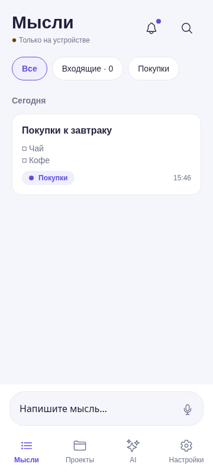
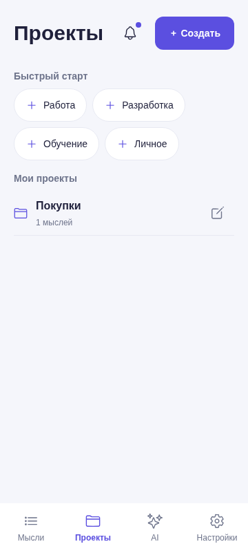
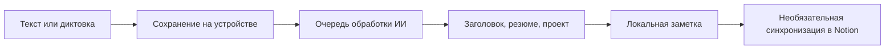

<div align="center">

# Thoughts

**Запиши мысль. Остальное разберёт ИИ.**

Заметки, идеи и задачи — текстом или голосом, с локальным сохранением и синхронизацией в Notion.

[](https://github.com/Tminww/ui-note-storage/actions/workflows/thoughts-ci.yml)
[](https://github.com/Tminww/ui-note-storage/actions/workflows/build-thoughts-apk.yml)
[](https://github.com/Tminww/ui-note-storage/actions/workflows/publish-thoughts-eas-update.yml)

[Скачать Android APK](https://github.com/Tminww/ui-note-storage/releases/latest) · [Запустить проект](thoughts-mvp/README.md) · [Выпуск версий](thoughts-mvp/README-PUBLISH.md)

</div>

## Быстро записать — легко найти

- **Текст и голос.** Напиши в поле ввода или начни диктовку. При вводе текста микрофон заменяется кнопкой сохранения.
- **ИИ разбирает мысли.** Создаёт короткий заголовок, резюме, списки и выбирает проект. Новые проекты и типы создаются автоматически; подтверждение можно включить в настройках.
- **Задачи со списками.** Отмечай выполненные пункты прямо в заметке.
- **Правки своими словами.** Нажми «Обработать ИИ ещё раз» и объясни, что изменить.
- **Локальное сохранение.** Мысли и черновик остаются на устройстве. Обработка и синхронизация продолжаются при появлении сети.
- **Notion по желанию.** Подключи свой аккаунт и выбери доступную страницу. Каждая новая мысль — сворачиваемая запись внутри проекта. Можно выбрать отдельную страницу для конкретного проекта.
- **Спокойный интерфейс.** Компактные проекты, поиск, темы оформления и уведомления под колокольчиком.

<p align="center">
  
  &nbsp;&nbsp;
  
</p>

## Установить и настроить

1. Скачай `app-release.apk` из [последнего релиза](https://github.com/Tminww/ui-note-storage/releases/latest) и установи на Android.
2. В **Настройки → Искусственный интеллект** добавь ключ OpenRouter или адрес собственного Thoughts API. Без ИИ текст всё равно сохраняется.
3. При желании открой **Настройки → Notion → Подключить Notion**. Войди в свой аккаунт, разреши доступ к нужным страницам и выбери место хранения. Можно создать страницу **Thoughts** внутри разрешённой страницы.
4. Совместимые обновления интерфейса приходят через Expo Update: **Настройки → Обновления → Проверить обновления → Применить**.

OAuth-подключение общее для приложения, но разрешения и токены индивидуальны: каждый человек получает доступ только к страницам, разрешённым его аккаунтом. Client Secret хранится на сервере, пользовательские токены — в защищённом хранилище телефона.

## Как устроено хранение



Исходный текст сохраняется до обращения к ИИ. В Notion выбирается общая страница, внутри неё создаются страницы проектов и сворачиваемые заметки. Старые заметки в виде отдельных страниц поддерживаются. Если мысль изменилась одновременно на устройстве и в Notion, приложение предлагает разрешить конфликт.

Диктовка использует системный сервис распознавания. Thoughts хранит расшифровку, а не аудиофайл. На Android 13+ включена непрерывная запись с паузой после четырёх секунд тишины; поведение на старых Android зависит от системного распознавателя. Для локального распознавания нужен установленный языковой пакет.

## Разработка

Основное приложение находится в **[`thoughts-mvp/`](thoughts-mvp/)**. Нужны Node.js 22.13+ и npm.

```bash
cd thoughts-mvp
npm ci
npm run web
```

Для проверки всех изменений:

```bash
npm run check:mobile
npm run lint
npm test
```

Android и iOS используют Expo SDK 58 / React Native, интерфейс — gluestack-ui v5 и UniWind. Голосу нужен нативный build; обычного Expo Go недостаточно. Веб-версия подходит для разработки интерфейса, OAuth Notion подключается в мобильном приложении.

| Каталог | Назначение |
| --- | --- |
| [`thoughts-mvp/apps/mobile`](thoughts-mvp/apps/mobile/) | Android, iOS, Web, локальная очередь, голос и Notion |
| [`thoughts-mvp/apps/api`](thoughts-mvp/apps/api/) | Необязательный Node.js API с SQLite и отдельный OAuth-сервис |
| [`thoughts-mvp/shared`](thoughts-mvp/shared/) | Общие схемы и обработка ответов ИИ |
| [`thoughts-mvp/deploy/notion-oauth`](thoughts-mvp/deploy/notion-oauth/) | Docker Compose и Nginx для OAuth |
| `src/` в корне | Ранний Vue-прототип, сохранён для истории |

## Ветки и публикация

**`master` — единственная постоянная ветка и источник релизов.** Изменения делаются в короткоживущих ветках `codex/*` или `feature/*`, объединяются в `master`, затем ветка удаляется. Отдельный workflow удаляет ветку после merge PR, если в ней не появилось новых коммитов.

| Workflow | Когда запускается | Результат |
| --- | --- | --- |
| **Delete merged working branch** | Закрытый объединённый PR | Удаление ветки без новых коммитов |
| **Thoughts checks** | Push в `master`, PR | Типы, линтер, тесты, web-сборка |
| **Build Thoughts Android APK** | Push в `master`, ручной запуск, публикация релиза без APK | APK и проверка в Android-эмуляторе |
| **Publish Thoughts EAS Update** | Изменения мобильного клиента / общего кода в `master` | OTA в канал `preview` |
| **Build Thoughts OAuth container** | Изменения OAuth / деплоя в `master` | Проверенный образ GHCR с тегами SHA и `latest` |

Сборка контейнера публикует образ; обновление VPS выполняется отдельно с закреплённым digest. Для собственного сервера: [инструкция OAuth](thoughts-mvp/docs/notion-oauth.md). Подробности APK, Expo Update и настройки GitHub: [выпуск версий](thoughts-mvp/README-PUBLISH.md).

## Текущее состояние

Версия **0.3.7**: сворачиваемые заметки Notion, автоматическое создание проектов, новый ввод, центр уведомлений, компактные проекты и исправления диктовки / ответов ИИ.

Android APK предназначен для тестирования и подписывается тестовым ключом; для магазина нужен отдельный ключ выпуска. iOS поддерживается исходным кодом, готового iOS-релиза пока нет. Системный голос, фоновые задачи и доставка OTA дополнительно проверяются на физическом устройстве.

[Архитектура локального хранения](thoughts-mvp/docs/local-first.md) · [Подключение Notion](thoughts-mvp/docs/notion-oauth.md) · [История релизов](https://github.com/Tminww/ui-note-storage/releases)
