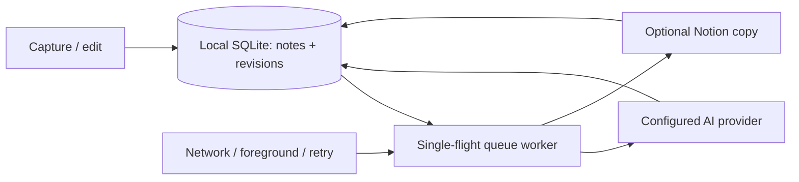

# Local-first Thoughts

The phone is the source of truth. A successful save means text and pending work have been committed locally, not that a network request succeeded. Notion is an optional synchronized copy; connecting it never removes the local copy.

## Pattern decisions

- Force: network availability and optional destinations vary independently from capture. Use a local Repository with a durable outbox represented by per-record revisions in the same SQLite document. Reject direct network writes from screens: a lost response must not lose a thought.
- Force: enrichment and Notion writes can finish after a user edits or deletes a record. Use optimistic revision checks and a single-flight worker. Store remote identities even for stale acknowledgements; never overwrite newer local text.
- Force: writes can succeed remotely while the response is lost. Notion records carry a stable local ID; the adapter reconciles before creating and patches owned blocks. Reject blind create retries and deletion of arbitrary paragraph blocks.
- Keep existing React state navigation and gluestack/Uniwind semantic tokens. No router migration or general plugin framework is needed.

The queue runs while the app is active, on reconnect and when returning to the app. Expo BackgroundTask additionally schedules best-effort background passes. SQLite compare-and-swap rebases concurrent foreground/background writes instead of overwriting them. Mobile operating systems may suspend a closed app; pending work resumes on the next launch. Credentials stay in SecureStore. Existing remote records are imported without overwriting dirty local records. Deletions remain as local tombstones so retries and imports cannot resurrect them.

Synced thoughts remember the Notion version they were based on. The client imports changes to the title and app-managed text, including checklist marks. If both versions changed, it pauses writes to that page until the user chooses the Notion version or keeps both as separate thoughts. The adapter checks the version again before writing. This is an optimistic check. Notion's block update API has no conditional write for making the check and patch atomic. Extra blocks authored in Notion and remote archival are outside this reconciliation.

Tests cover restart, storage failure, lost acknowledgements, stale AI results, edits/deletes during sync, destination changes and idempotent retry. Native microphone and OTA delivery also require an installed device build.
